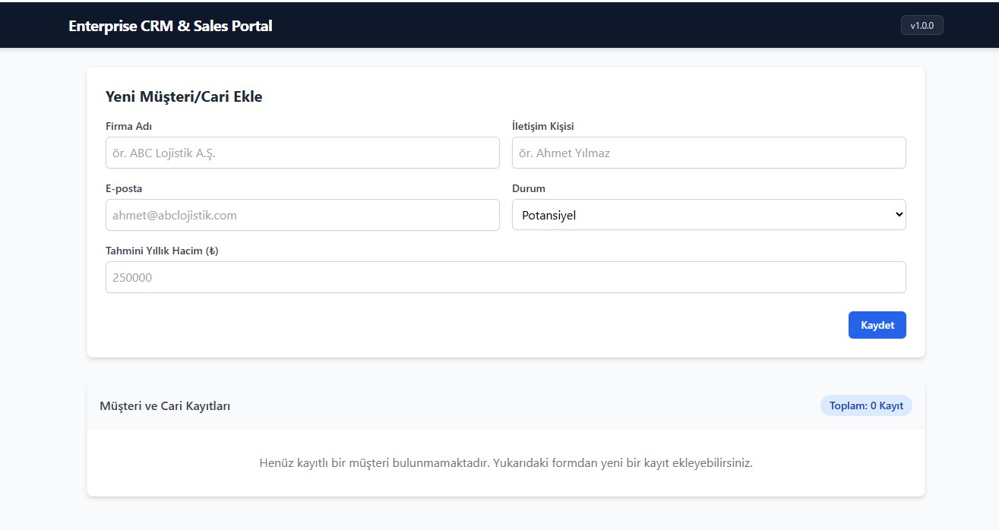

# ERP / CRM Web Yönetim Sistemi

İşletmelerin müşteri ilişkilerini (CRM), cari hesap hareketlerini ve operasyonel süreçlerini tek bir merkezden yönetebilmesi amacıyla React ve TypeScript kullanılarak geliştirilmiş kurumsal web uygulaması.

**Canlı Demo:** [https://web-gelistirme-js-erp-crm.netlify.app/]https://web-gelistirme-js-erp-crm.netlify.app/)

---

## Ekran Görüntüsü



---

## Temel Özellikler

* **Yönetim Paneli (Dashboard):** Toplam cari bakiyeler, aktif müşteri sayıları ve finansal özetlerin anlık takibi.
* **Müşteri ve Cari Yönetimi (CRM):** Yeni müşteri veya firma kaydı oluşturma, bilgi güncelleme, silme ve cari bakiye görüntüleme.
* **Finansal Hareket Takibi:** Borç, alacak, tahsilat ve ödeme işlemlerinin tarih ve açıklama bazlı kayıt yönetimi.
* **Arama ve Filtreleme:** Müşteri adı, kategori veya işlem durumuna göre anlık dinamik filtreleme.
* **Kalıcı Veri Depolama:** Harici bir sunucu bağımlılığı olmaksızın tarayıcı LocalStorage altyapısı ile kalıcı veri saklama.
* **Duyarlı (Responsive) Arayüz:** Masaüstü, tablet ve mobil ekran boyutlarıyla uyumlu modern tasarım.

---

## Teknoloji Yığını

* **Frontend:** React, TypeScript
* **Build Aracı:** Vite
* **Stil ve Arayüz:** Tailwind CSS
* **Veri Yönetimi:** React Hooks, LocalStorage API
* **Deployment:** GitHub, Netlify

---

## Kurulum ve Çalıştırma

Projeyi yerel ortamınızda çalıştırmak için aşağıdaki adımları sırasıyla izleyin:

1. **Depoyu klonlayın:**
   ```bash
   git clone [https://github.com/ZekeriyaKali/web_gelistirme_javascript.git](https://github.com/ZekeriyaKali/web_gelistirme_javascript.git)
   ```

2. **Proje dizinine geçin:**
   ```bash
   cd web_gelistirme_javascript
   ```

3. **Gerekli bağımlılıkları yükleyin:**
   ```bash
   npm install
   ```

4. **Geliştirme sunucusunu başlatın:**
   ```bash
   npm run dev
   ```
   Uygulama varsayılan olarak `http://localhost:5173` adresi üzerinden erişilebilir olacaktır.